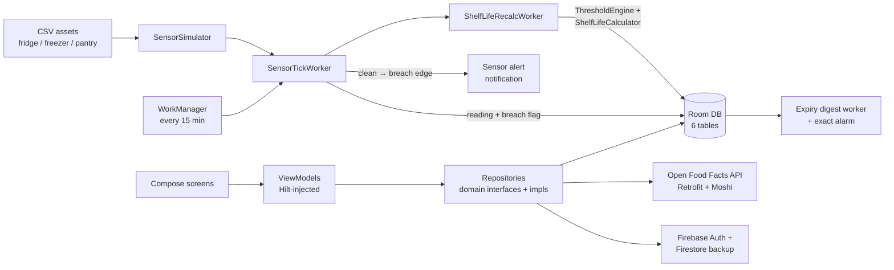

# SmartPantry: an offline-first Android app that tracks food, storage conditions and waste

SmartPantry is a native Android app (Kotlin, Jetpack Compose) for keeping track of the food in a home.
Items go into a local **Room** database with a purchase date and a nominal expiry date; the app then
watches simulated **fridge, freezer and pantry sensors** (temperature, humidity, light), flags readings
that break each storage zone's thresholds, and **shortens an item's effective shelf life** when it has
been stored badly. Around that core it adds barcode lookup through the **Open Food Facts** API, expiry
reminders, a waste log with **CO2e estimates**, waste analytics, a shopping list that suggests restocks
from waste history, and **Firebase** sign-in with a Firestore backup of the user's data.

Everything below is taken from the code in this repository.

**Team project.** SmartPantry was designed and built by a small team of developers, each owning
different features. See [Team and my contributions](#team-and-my-contributions).

## What it does at a glance

| What | Detail |
| --- | --- |
| Screens | **20** Compose screens wired into one navigation graph ([`AppNavigation.kt`](app/src/main/java/com/lab03g10/smartpantry/AppNavigation.kt)), with a bottom bar for the main tabs |
| Local data | Room database, **6 entities / 6 DAOs** (food items, sensors, sensor readings, waste log, notifications, shopping), schema **version 6** |
| Sensor pipeline | **3** sensor zones, each replaying a **200-row** CSV every **15 minutes** via WorkManager; readings are checked against per-zone thresholds (fridge > 7 °C, freezer > -15 °C, pantry > 28 °C or > 300 lux) |
| Shelf-life model | Breach readings consume shelf life at **2x**, in-range readings at **0.9x**, over a **7-day** look-back window, recalculated after every sensor tick |
| Background work | **3** WorkManager workers (sensor tick, shelf-life recalculation, daily 9 am expiry digest) plus an exact-alarm expiry reminder that is re-armed on boot |
| Notifications | **4** channels (expiry, sensor alerts, shopping, low stock), all gated by one permission + quiet-hours check |
| Cloud | Firebase Auth (email/password, password reset, Google sign-in via Credential Manager) and Firestore push/pull backup under `users/{uid}/…` |
| Tests | **33** JVM unit tests across 6 test classes (simulator, threshold engine, shelf-life calculator, sensor worker, date utilities, add/edit save logic) |
| Platform | minSdk **26**, target/compile SDK **36**, Java 17 toolchain, about 18k lines of Kotlin in `app/src/main` |

## Architecture



* **Layers:** `ui` (screens, components, ViewModels) → `domain` (repository interfaces, models, use cases)
  → `data` (Room, Retrofit, Firebase, sensor simulation). Dependencies are provided by **Hilt** modules in
  [`di/`](app/src/main/java/com/lab03g10/smartpantry/di/).
* **Offline-first:** Room is the source of truth and every screen observes it as a `Flow`; Firestore is
  only used for an explicit backup and restore of the user's data.

## Repository layout

| Path | What's inside |
| --- | --- |
| [`app/src/main/java/.../ui/`](app/src/main/java/com/lab03g10/smartpantry/ui/) | 20 screens, 4 shared components, 20 ViewModels, Material 3 theme |
| [`app/src/main/java/.../domain/`](app/src/main/java/com/lab03g10/smartpantry/domain/) | Repository interfaces, models, and use cases (`ShelfLifeCalculator`, `Co2eCalculator`, `LookupBarcodeUseCase`) |
| [`app/src/main/java/.../data/local/`](app/src/main/java/com/lab03g10/smartpantry/data/local/) | Room database, entities and DAOs |
| [`app/src/main/java/.../data/remote/`](app/src/main/java/com/lab03g10/smartpantry/data/remote/) | Open Food Facts Retrofit interface and DTOs |
| [`app/src/main/java/.../data/sensor/`](app/src/main/java/com/lab03g10/smartpantry/data/sensor/) | CSV-driven `SensorSimulator` and the `ThresholdEngine` |
| [`app/src/main/java/.../data/repository/`](app/src/main/java/com/lab03g10/smartpantry/data/repository/) | Repository implementations, including the Firestore `BackupRepository` |
| [`app/src/main/java/.../worker/`](app/src/main/java/com/lab03g10/smartpantry/worker/) | WorkManager workers and schedulers |
| [`app/src/main/java/.../notification/`](app/src/main/java/com/lab03g10/smartpantry/notification/) | Channels, notifiers, exact-alarm scheduler, boot receiver, `NotificationGuard` |
| [`app/src/main/assets/sensors/`](app/src/main/assets/sensors/) | Pre-generated sensor CSVs (`epochSec,tempC,humidity,lux`) |
| [`app/src/test/`](app/src/test/) | JUnit 4 + Mockito + coroutines-test unit tests |
| [`app/schemas/`](app/schemas/) | Exported Room schema JSON |
| [`tools/gen_sensor_csv.py`](tools/gen_sensor_csv.py) | Script that builds the sensor CSVs from public IoT datasets |

## Notable engineering decisions

1. **Shelf life that reacts to storage conditions.** Each food item stores both a `nominalExpiryDate`
   and an `effectiveExpiryDate`. After every sensor tick, `ShelfLifeRecalcWorker` counts breach vs
   in-range readings for the item's storage zone and `ShelfLifeCalculator` moves the effective date
   (breaches age food 2x faster, good storage 0.9x). Results are clamped so an expiry date is never set
   in the past.
2. **No false history after moving food.** Items record `storageChangedAt`; the recalculation only uses
   readings taken *after* an item arrived in its current zone, so food moved out of the freezer is not
   penalised for the fridge's older breaches.
3. **Alert on transitions, not on every tick.** The sensor worker reads the previous breach flag before
   inserting a new reading and only notifies on a clean-to-breach edge, so a sustained breach produces
   one alert instead of one every 15 minutes.
4. **Realistic simulated sensors.** Instead of random numbers, the three CSVs are derived from two public
   IoT telemetry datasets: temperatures are offset into fridge/freezer ranges while keeping the original
   noise and timing, and breach readings come from warmer source devices. Generation is seeded, so the
   output is reproducible.
5. **One gate for all notifications.** Expiry and sensor notifiers both go through `NotificationGuard`,
   which checks Android 13+ notification permission and the user's quiet-hours window in one place.
6. **CO2e stored at write time.** Waste entries persist their CO2e grams (per-category kg CO2e/kg factors
   in `Co2eCalculator`), so analytics totals do not shift if the factors are later changed.
7. **Restock suggestions from waste.** The shopping list suggests restocking any item wasted 3 or more
   times, skips items already on the list, and hides dismissed suggestions for 3 days.
8. **Build tooling.** Room and Moshi use **KSP**; Hilt uses **KAPT** to avoid a KSP2 processing issue
   with Hilt-generated code (documented in [`app/build.gradle.kts`](app/build.gradle.kts)).

## Current limitations

* The scanner screen does not use the camera yet: barcodes are typed in (or a demo barcode is used) and
  then looked up on Open Food Facts.
* Sensor data is simulated from bundled CSVs; there is no hardware integration.
* Database upgrades use `fallbackToDestructiveMigration()` (the database is re-seeded on a schema change),
  which suits development but not production.

## Tech stack

Kotlin, Jetpack Compose, Material 3, Navigation Compose, Hilt (Dagger), Room, WorkManager, DataStore,
Retrofit, OkHttp, Moshi, Coil, Firebase Authentication, Cloud Firestore, Android Credential Manager
(Google sign-in), AlarmManager, Kotlin Coroutines and Flow, JUnit 4, Mockito, Gradle (Kotlin DSL,
version catalog), Python (data generation).

## Run it yourself

Requirements: Android Studio with JDK 17 and Android SDK 36.

```bash
git clone https://github.com/anbu0606/smartpantry_app.git
cd smartpantry_app

# Unit tests (no device needed)
./gradlew testDebugUnitTest

# Install on a running emulator or device
./gradlew installDebug
```

Firebase features need a `app/google-services.json` for a Firebase project with Email/Password and
Google sign-in enabled, and Firestore created. The inventory, sensors, analytics and shopping list work
locally without signing in to the backup.

To regenerate the sensor CSVs, download the two datasets listed below into `tools/kaggle_data/` (or set
the `KAGGLE_DIR` environment variable to their folder) and run `python tools/gen_sensor_csv.py`.

## Team and my contributions

Built as a team project. Team members:

<!-- Fill in names and GitHub profile links, e.g. - [Name](https://github.com/handle): sensors and shelf-life engine -->
- _Name_ (GitHub link): area owned
- _Name_ (GitHub link): area owned
- _Name_ (GitHub link): area owned
- _Name_ (GitHub link): area owned

**My part (Anbu Chandran, [@anbu0606](https://github.com/anbu0606))** — the inventory and barcode flow:

- **Inventory list** ([`InventoryListScreen`](app/src/main/java/com/lab03g10/smartpantry/ui/screens/InventoryListScreen.kt),
  [`InventoryViewModel`](app/src/main/java/com/lab03g10/smartpantry/ui/viewmodel/InventoryViewModel.kt)): wired to the
  `FoodRepository` with live search and category filtering.
- **Add / edit food form** with validation and Room persistence
  ([`AddEditFoodScreen`](app/src/main/java/com/lab03g10/smartpantry/ui/screens/AddEditFoodScreen.kt),
  [`AddEditFoodViewModel`](app/src/main/java/com/lab03g10/smartpantry/ui/viewmodel/AddEditFoodViewModel.kt)).
- **Food detail screen** for marking items consumed or wasted, feeding the waste log.
- **Open Food Facts integration:** Retrofit + Moshi API setup and DTOs
  ([`OpenFoodFactsApi`](app/src/main/java/com/lab03g10/smartpantry/data/remote/OpenFoodFactsApi.kt),
  [`NetworkModule`](app/src/main/java/com/lab03g10/smartpantry/di/NetworkModule.kt)).
- **Barcode lookup** use case with an offline cache
  ([`LookupBarcodeUseCase`](app/src/main/java/com/lab03g10/smartpantry/domain/usecase/LookupBarcodeUseCase.kt)),
  the scan-result screen and ViewModel with real loading / found / not-found / error states, and
  passing the result through navigation so "Add to inventory" pre-fills the add-food form.

## Acknowledgements

* Product data: [Open Food Facts](https://world.openfoodfacts.org/) (Open Database License).
* Sensor data is derived from *Environmental Sensor Telemetry Data* (Gary Stafford, Kaggle) and
  *IoT-Based Environmental Dataset* (Ziya, Kaggle).
* CO2e factors follow Poore & Nemecek (2018), "Reducing food's environmental impacts through producers
  and consumers", *Science* 360.
